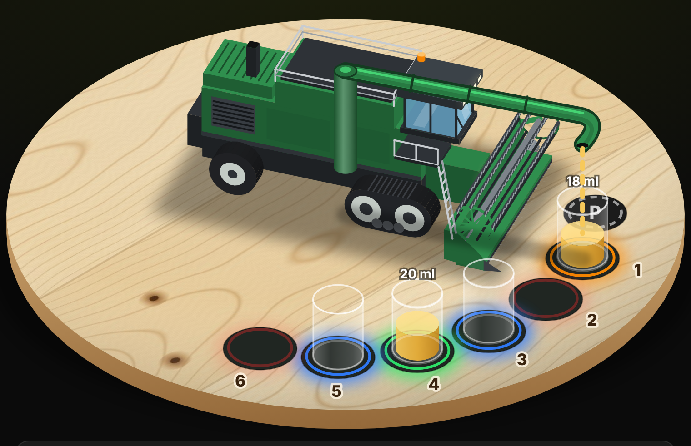
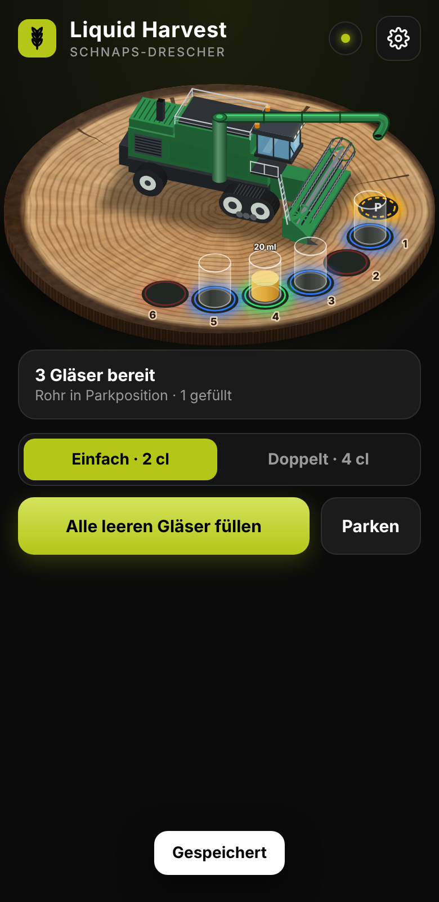
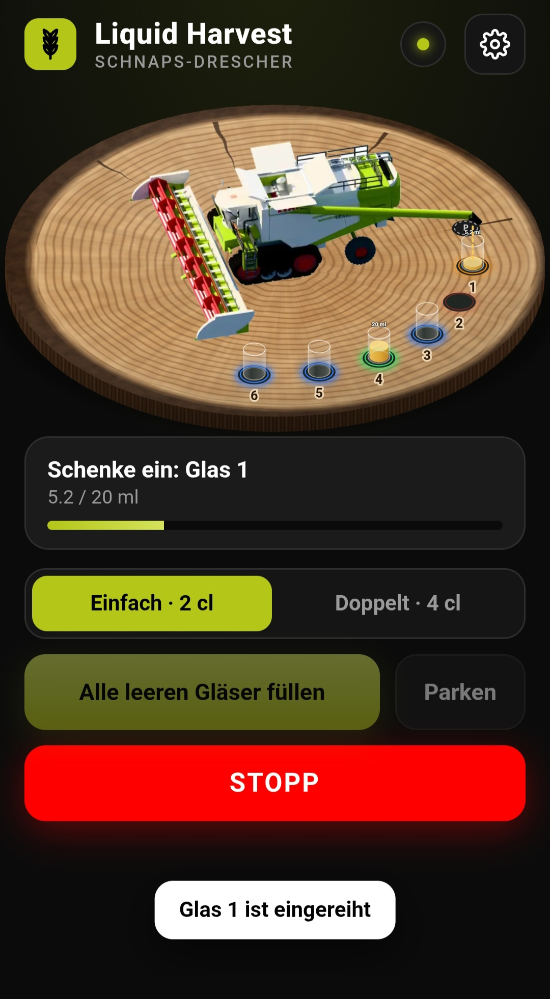
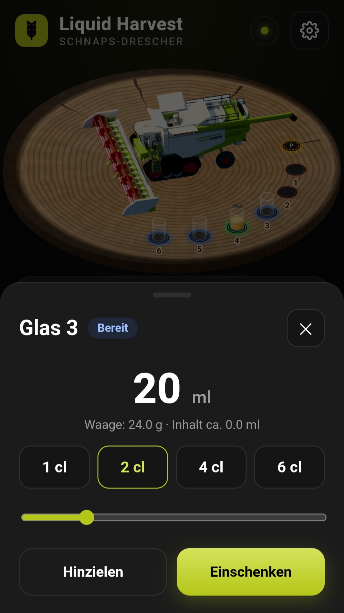
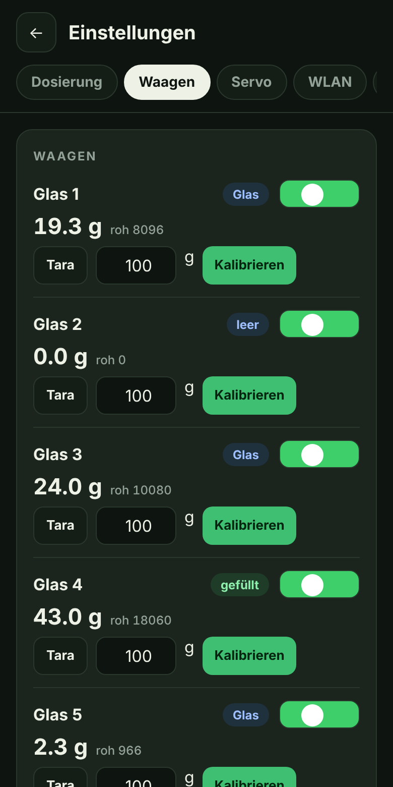
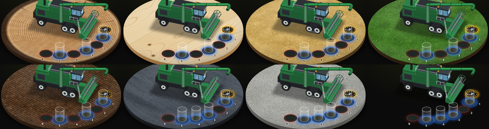
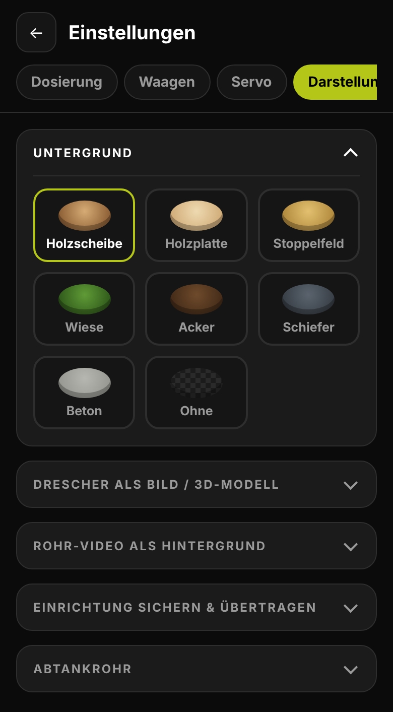
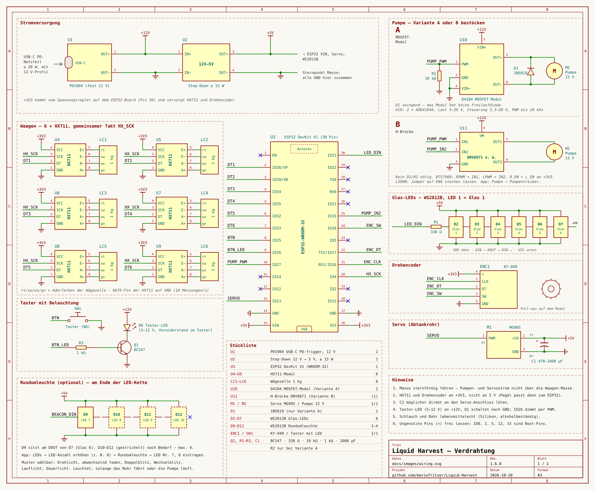
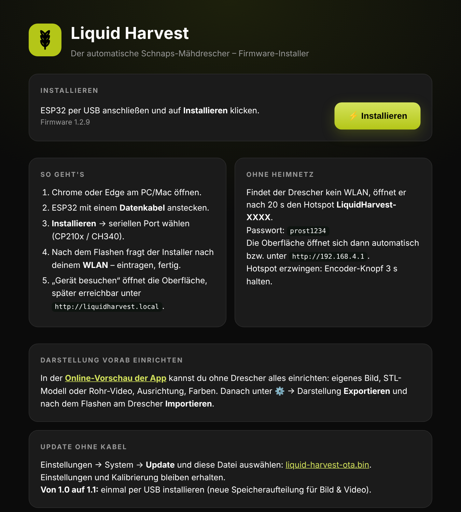
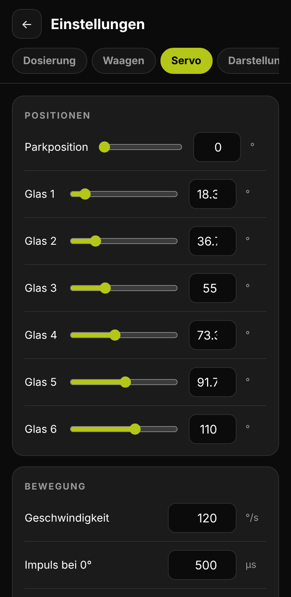

# 🌾 Liquid Harvest – der Schnaps-Mähdrescher

Ein Spielzeug-Mähdrescher, der mit seinem Abtankrohr bis zu **6 Gläser** anfährt und per Peristaltikpumpe **grammgenau** einschenkt. Jeder Platz hat eine eigene Wägezelle (Glaserkennung + Dosierung) und eine WS2812B-LED.

<p align="center"></p>

<p align="center"><a href="https://mariofritzer.github.io/Liquid-Harvest/"><b>⚡ Web-Installer öffnen</b></a> · <a href="#verdrahtung">Verdrahtung</a> · <a href="#bedienung-am-gerät">Bedienung</a> · <a href="#rest-api">API</a></p>

**➜ Firmware installieren:** [mariofritzer.github.io/Liquid-Harvest](https://mariofritzer.github.io/Liquid-Harvest/) in Chrome oder Edge öffnen, ESP32 per USB anstecken, auf *Installieren* klicken. Danach fragt der Installer direkt nach den WLAN-Daten (Improv).

---

## Weboberfläche

| Live-Ansicht | Einschenken | Glas antippen | Waagen kalibrieren |
|:---:|:---:|:---:|:---:|
|  |  |  |  |
| Gläser poppen auf, sobald sie auf der Waage stehen | Fortschritt, Warteschlange, Notstopp | Menge wählen und starten | Tara + Kalibrierung pro Platz |

### Untergründe & Darstellung

<table align="center">
  <tr>
    <td align="center" valign="bottom"></td>
    <td align="center" valign="bottom"></td>
  </tr>
  <tr>
    <td align="center"><sub><b>Am PC</b></sub></td>
    <td align="center"><sub><b>Am Handy</b></sub></td>
  </tr>
</table>

<p align="center"><sub>Untergründe: Holzscheibe · Holzplatte · Stoppelfeld · Wiese · Acker · Schiefer · Beton · ohne – die Glasnummern passen ihre Farbe automatisch an.<br>Die Bereiche unter „Darstellung“ lassen sich einzeln auf- und zuklappen.</sub></p>

**Online-Vorschau:** [mariofritzer.github.io/Liquid-Harvest/app/](https://mariofritzer.github.io/Liquid-Harvest/app/) – die komplette App als Simulation, ohne Hardware. Dort kannst du Bild, STL-Modell, Rohr-Video, Ausrichtung und Farben vorab einrichten, unter ⚙️ → Darstellung **exportieren** und nach dem Flashen am Drescher **importieren**.

## Funktionen

| | |
|---|---|
| **Glaserkennung** | Schwelle einstellbar ab 0,1 g (Standard 1,5 g, auch Plastikstamperl), Gewicht muss 0,5 s ruhig sein, Drift-Kompensation, Nullung beim Einschalten |
| **Dosierung** | nach Gewicht: schnell → langsam (PWM) → Stopp vor dem Ziel (Nachlauf) → Nachtropfzeit · **Nachlauf lernt sich selbst ein** (korrigiert „Stopp vorher“ nach jedem Glas) · einstellbare Pause nach dem Einfüllen, damit Tropfen noch ins Glas fallen, bevor das Rohr schwenkt |
| **Pumpentreiber** | wählbar: MOSFET-Modul (D4184) oder **H-Brücke** (DRV8871, BTS7960, L298N) – mit H-Brücke saugt die Pumpe nach dem Einschenken kurz zurück, kein Nachtropfen beim Schwenken |
| **Reinigung** | geführtes Spülprogramm (Spülen → Leer pumpen → fertig) an wählbarer Position (Park oder Glas 1–6), Erinnerung nach X Gläsern oder Y Tagen (Uhrzeit per NTP aus dem Heimnetz) |
| **Rundumleuchte** | 1–4 zusätzliche WS2812B am Ende der LED-Kette blitzen als Rundumleuchte, solange das Rohr fährt oder die Pumpe läuft; Muster (Drehlicht, abwechselnd faden, Doppelblitz, Wechselblitz, Lauflicht, Dauerlicht), Farbe und Helligkeit einstellbar |
| **Zähler** | Stamperl und Liter für die aktuelle Session und insgesamt, auf der Startseite und unter ⚙️ System; Zurücksetzen nur nach Eintippen von „reset“ |
| **Sicherheit** | Glas weg = sofort Stopp · kein Durchfluss nach X s = Abbruch (einstellbar) · Pumpe nur bei stehendem Rohr · Höchstdauer pro Glas · Taster = Notstopp |
| **Offline** | Encoder schwenkt das Rohr, Taster schenkt ein, Auto-Fill aus der Parkposition |
| **Online** | isometrische 3D-Ansicht am Handy, Gläser poppen live auf, Klick → Menge wählen → einschenken |
| **WLAN** | Heimnetz mit `http://liquidharvest.local`, Hotspot als Rückfall bzw. Party-Modus, Captive Portal |
| **Eigenes Drescher-Bild** | eigenes Foto oder **STL-3D-Modell** hochladen (wird im Browser isometrisch gerendert), Hintergrund automatisch freistellen, Position einstellen – das Abtankrohr schwenkt live darüber |
| **Rohr-Video** | eigenes Video (Rohr fährt Park → Glas 1 … 6) hochladen – Haltepunkte, Rohrspitzen und Parkposition werden erkannt, Hintergrund freigestellt, Gläser automatisch unter den Auslauf gesetzt; die App zeigt immer das Bild zum echten Servo-Winkel |
| **Glas-LEDs** | Anzahl der LEDs in der Kette und Zuordnung frei einstellbar (beliebig viele LEDs pro Glas), mit Test-Knopf; Farbe (Farbwähler oder R/G/B-Werte 0–255), Helligkeit und Effekt je Zustand einstellbar, mit Vorschau |
| **Taster-LED** | zeigt den Zustand (bereit, Rohr über Glas, schenkt ein, Fehler, alle gefüllt …) – Effekt je Zustand wählbar, kurzes Aus quittiert jeden Klick |
| **Servo** | Schwenkbereich einlernen: mit −/+ an den Anschlag fahren → „Hier ist Min“ (= 0°) bzw. „Hier ist Max“ – das Rohr fährt danach nie mehr darüber hinaus, auch nicht über Regler, Encoder oder Ausschank · Drehrichtung umkehrbar, jede Position per „Anfahren“ testbar · nach Erreichen der Position stromlos (kein Brummen), beim Einschenken aber angesteuert, damit ein Stoß das Rohr nicht vom Glas wegdreht |
| **Untergrund** | Holzscheibe, Holzplatte, Stoppelfeld, Wiese, Acker, Schiefer, Beton oder ohne – realistische Texturen, im Browser erzeugt |
| **Standard-Einrichtung** | Export aus der App als `setup/default-setup.json` ins Repo → wird beim Flashen mitinstalliert; jeder Build prüft das Image und startet es testweise im ESP32-Emulator |
| **Updates** | **Online-Update per Klick** (ab 1.8.0): der Drescher prüft beim Start und alle 12 h bei GitHub, ob es eine neue Version gibt, und zeigt dann einen Hinweis auf der Startseite. Unter ⚙️ System lässt sich jede veröffentlichte Version auswählen und installieren – nur wenn GitHub erreichbar ist, über eine gesicherte Verbindung (eingebaute Root-Zertifikate). Daneben weiterhin Web-Installer per USB oder Update aus Datei |
| **API** | REST für Home Assistant & Co. |

## Bedienung am Gerät

| Aktion | Wirkung |
|---|---|
| Encoder drehen | Rohr fährt Park → Glas 1 … Glas 6 |
| Taster 1× (über Glas) | Einfach-Shot (Standard 20 ml) |
| Taster 2× (über Glas) | Doppel-Shot (Standard 40 ml) |
| Taster 1× / 2× in Parkposition | **Auto-Fill**: alle blauen Gläser nacheinander, danach parken |
| Taster während Ausschank | **Notstopp** |
| Taster halten in Parkposition | Pumpe läuft solange gedrückt (Schlauch füllen) |
| Encoder-Knopf 1× | Rohr parken |
| Encoder-Knopf 3 s | Hotspot **ohne Passwort** ein (Glas-LEDs blinken blau) · nochmal 3 s: aus (rot) |

### LED-Farben

| Farbe | Bedeutung |
|---|---|
| schwach rot | kein Glas |
| blau | Glas erkannt, bereit |
| gelb/orange pulsierend | Rohr zielt auf dieses Glas |
| orange schnell pulsierend | schenkt gerade ein |
| grün | fertig – wartet auf Entnahme |
| rot blinkend | Fehler (Glas weg, kein Durchfluss …) |
| violett blinkend | Waage liefert keine Daten |

## Verdrahtung

<p align="center"></p>

## Pinbelegung (ESP32 DevKit, WROOM-32)

| Bauteil | GPIO | Hinweis |
|---|---|---|
| HX711 SCK (alle 6 gemeinsam) | **4** | |
| HX711 DT Glas 1…6 | **36, 39, 34, 35, 32, 33** | liegen alle im Register `GPIO_IN1` → 6 Waagen werden mit einem Zugriff gleichzeitig gelesen |
| Servo MG90S | **13** | |
| Pumpe: MOSFET-Modul PWM **bzw.** H-Brücke IN1 | **27** | PWM 1 kHz, vorwärts |
| H-Brücke IN2 (nur H-Brücke) | **19** | PWM 1 kHz, rückwärts (Zurücksaugen) |
| WS2812B Data-In | **23** | LED 1 = Glas 1 |
| Taster | **25** | gegen GND (interner Pull-up) |
| Taster-LED | **26** | PWM |
| KY-040 CLK / DT / SW | **16 / 17 / 18** | |

**Warum so?** Keine Strapping-Pins (0, 2, 5, 12, 15), keine Flash-Pins, und die reinen Eingänge 34–39 werden sinnvoll für die HX711-Datenleitungen genutzt. Frei bleiben u. a. GPIO 21, 22 (I²C z. B. für ein OLED) und 14.

> ⚠️ Bei einem **ESP32-WROVER** sind GPIO 16/17 durch den PSRAM belegt – dann Encoder auf 21/22 legen (`src/pins.h`).

## Verdrahtungs-Tipps

- **Servo:** 470–1000 µF Elko direkt an 5 V/GND des Servos.
- **Pumpe:** Freilaufdiode 1N5819 antiparallel zur Pumpe ist Pflicht – das D4184-Modul (2 × AOD4184A) hat keine. 10 kΩ Pulldown PWM→GND, damit die Pumpe beim Booten sicher aus ist.
- **Taster-LED** (5–12 V, Vorwiderstand eingebaut): „+“ an +12 V, „−“ über NPN-Transistor (BC547, 1 kΩ an der Basis) nach GND – GPIO 26 schaltet bzw. dimmt.
- **H-Brücke statt MOSFET:** in der App unter ⚙️ Dosierung → Pumpentreiber auswählen, dort steht auch die Pinbelegung. **DRV8871** empfohlen (IN1→27, IN2→19, VM→+12 V, OUT1/OUT2→Pumpe). **BTS7960:** RPWM→27, LPWM→19, R_EN und L_EN an 3,3 V. **L298N:** IN1→27, IN2→19, Jumper auf ENA stecken lassen. Die Freilaufdiode D1 entfällt (Brücke hat eigene).
- **Rundumleuchte:** einfach eine weitere WS2812B ans Ende der Kette hängen und im LED-Reiter ihre Nummer eintragen.
- **Masse:** sternförmig führen, Pumpen-/Servostrom nicht über die HX711-Masse.
- **HX711:** RATE-Pin auf GND (10 Messungen/s, rauschärmer). Nicht angeschlossene Waagen in den Einstellungen deaktivieren.
- Schlauch und Rohr **lebensmittelecht** (Silikon, alkoholbeständig).

## Web-Installer

<p align="center"></p>

> **Ab Version 1.1** ist der Datenspeicher größer (für Bild und Video). Beim Umstieg von 1.0 einmal **per USB über den Web-Installer** neu installieren – ein OTA-Update reicht dafür nicht.

## Eigene Standard-Einrichtung mitflashen (ab 1.2)

Exportdatei aus der App als `setup/default-setup.json` ins Repo legen – der Build packt Bild, Video und Darstellung ins Dateisystem des Web-Installers. Nach dem Flashen ist alles sofort aktiv; „Werkseinstellungen“ stellt wieder diese Einrichtung her. Achtung: die Datei wird mit dem Repo veröffentlicht.

## Erste Inbetriebnahme

1. Firmware über den Web-Installer flashen, WLAN eintragen.
2. Oberfläche öffnen → ⚙️ **Waagen**: jede Waage leer *Tara*, dann bekanntes Gewicht auflegen → *Kalibrieren*.
3. ⚙️ **Servo**: Parkposition und die 6 Glaspositionen mit den Reglern live einstellen → *Speichern*.

   

4. ⚙️ **System** → *Schlauch füllen* (Becher unter den Auslauf in Parkposition).
5. Optional ⚙️ **Drescher-Bild**: Foto deines eigenen Modells hochladen (am besten schräg von oben vor einfarbigem Hintergrund) und mit *Position anpassen* ausrichten. Das Bild wird nur auf dem ESP32 gespeichert.
6. ⚙️ **Dosierung**: Probe-Shot, bei zu viel im Glas „Stopp vorher“ erhöhen.

## REST-API

```
GET  /api/state                   # kompletter Status als JSON
POST /api/pour?p=3&ml=20          # Glas 3 befüllen
POST /api/autofill?ml=20          # alle leeren Gläser
POST /api/stop
```

WebSocket `ws://<ip>/ws` liefert Status (`{"t":"st",…}`) und Events (`{"t":"ev","e":"glass_on","p":3}` = „Glas_3_da“).

## Selbst bauen

```bash
pip install platformio
pio run -e esp32              # bauen
pio run -e esp32 -t upload    # per USB flashen
pio device monitor            # serielle Ausgabe
```

Die Weboberfläche liegt in `web/index.html` und wird beim Build automatisch gzip-komprimiert in die Firmware eingebettet. Zum Gestalten ohne Hardware: `web/index.html?demo` im Browser öffnen (Simulation).

Jeder Push auf `main` baut die Firmware und aktualisiert den Web-Installer. Ist `FW_VERSION` in `src/version.h` neu, wird automatisch ein GitHub-Release `vX.Y.Z` angelegt – daraus holen sich die Geräte ihre Online-Updates. Der Build prüft dabei am echten GitHub, dass Zertifikate, Release-Liste und Download für den ESP32 funktionieren.

## Projektstruktur

```
src/            Firmware (main.cpp, scales.cpp, settings.cpp, improv_serial.cpp, pins.h)
web/            Weboberfläche (eine Datei, wird eingebettet)
docs/images/    Bilder für diese README
flasher/        Web-Installer (GitHub Pages, ESP Web Tools)
scripts/        Build-Helfer (Web einbetten, Flash-Image zusammenführen)
.github/        GitHub Actions: Build + Pages-Deploy + Releases
```
